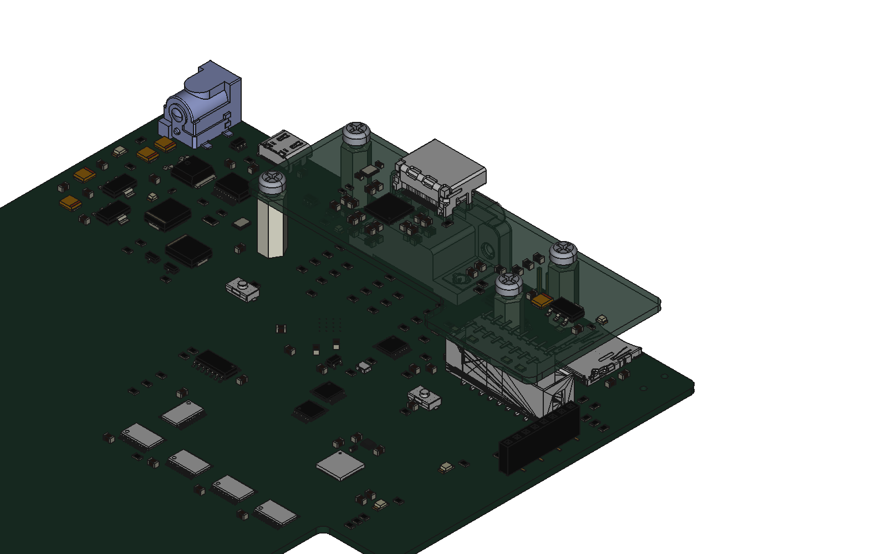

# Mechanical BOM and stacking

The VERA-HDMI-Expansion board is mounted on top of the **VERA-MODULE-RBL-XE**
board with four M3 standoffs. The 2x08 socket **J2** on the bottom side of the
HDMI board plugs into the 2x08 box header **J1** on the top side of the module.

  

3D model of the stack: [`images/VERA-XE-HDMI-assembly.step`](../images/VERA-XE-HDMI-assembly.step)
(STEP AP214) and [`images/VERA-XE-HDMI-assembly.FCStd`](../images/VERA-XE-HDMI-assembly.FCStd)
(FreeCAD 0.19).

## Parts for one assembly

| Qty | Part | Description | Example part numbers |
|----:|------|-------------|----------------------|
| 4 | Standoff | Hex standoff, M3 female/female, **14 mm**, 5.5 mm across flats, nylon 6/6 | Essentra MTS-14 |
| 8 | Screw | **M3 x 6** pan head, cross recess (ISO 7045), 4 on the top side, 4 on the bottom side | any ISO 7045 M3x6 |

A brass standoff can replace the nylon one: Harwin R30-1001402 or
Essentra 301314040050 (M3 F/F, 14 mm, 5 mm across flats, nickel plated brass).
Nylon is preferred, so the standoffs do not connect the mounting holes of the
two boards electrically.

The board-to-board connector parts are in the electrical BOM of each board:

| Board | Ref | Part | LCSC |
|-------|-----|------|------|
| VERA-MODULE-RBL-XE | J1 | HanXia HX JN2.54-2x8P TP H8.9, SMD box header 2x08, 2.54 mm | C41376031 |
| VERA-HDMI-Expansion | J2 | HCTL PM254-2-08-S-8.5, SMD female header 2x08, 2.54 mm, 8.5 mm insulator | C3975153 |

## Mounting holes

The four M3 holes (3.2 mm, no annular ring) of the two boards are aligned:

| Hole | VERA-MODULE-RBL-XE (mm) | VERA-HDMI-Expansion (mm) |
|------|------------------------|--------------------------|
| H1 | 181.5, 51.0 | 111.0, 79.9 |
| H2 | 181.5, 75.0 | 111.0, 103.9 |
| H3 | 240.5, 66.5 | 170.0, 95.4 |
| H4 | 240.5, 51.0 | 170.0, 79.9 |

The HDMI board coordinates are the module coordinates moved by (-70.5, +28.9) mm.
J2 at (180.39, 105.44) lies over J1 at (250.89, 76.54), so pin n of J2 mates
pin n of J1.

## Stack heights

Heights above the top face of the VERA-MODULE-RBL-XE board (where the standoffs
sit), from the 3D models; the parts sit about 0.05 mm higher, on their pads:

| Item | Height (mm) |
|------|------------:|
| J1 box header, cavity floor | 3.35 |
| J2 socket, mating face | 5.5 |
| J1 pin tips | 9.05 |
| J1 box header, top | 9.65 |
| DB15 VGA connector (J2 of the module), top | 12.6 |
| Lowest bottom-side part of the HDMI board over the DB15 (0805 capacitors) | 12.7 |
| **HDMI board, bottom face (standoff length)** | **14.0** |

- **Pin engagement:** 9.05 - 5.5 = **about 3.5 mm**. The socket stays about
  2.15 mm above the cavity floor, so the standoffs set the height, not the connector.
- **DB15 clearance:** about **0.1 mm** between the DB15 and the 0805
  capacitors on the bottom side of the HDMI board. A 13 mm standoff makes them
  collide. Check the height of the DB15 actually fitted: the 3D model is the
  Amphenol ICD15S13E4GX00LF, the footprint is the CONNFLY DS1038-15F.
- **Screws:** each M3x6 screw goes 4.4 mm into the standoff (6 mm - 1.6 mm board).
  The two screw tips stay 5.25 mm apart inside the 14 mm standoff.
- No component of either board enters the standoff or screw head area
  (5.5 mm hex, 5.6 mm head, 0.2 mm margin).

## Assembly

1. Screw the four standoffs to the VERA-MODULE-RBL-XE board with four M3x6
   screws from the bottom side.
2. Put the HDMI board on the standoffs, with J2 over J1, and press it down so
   J2 goes into J1.
3. Fix the HDMI board with four M3x6 screws from the top side.
